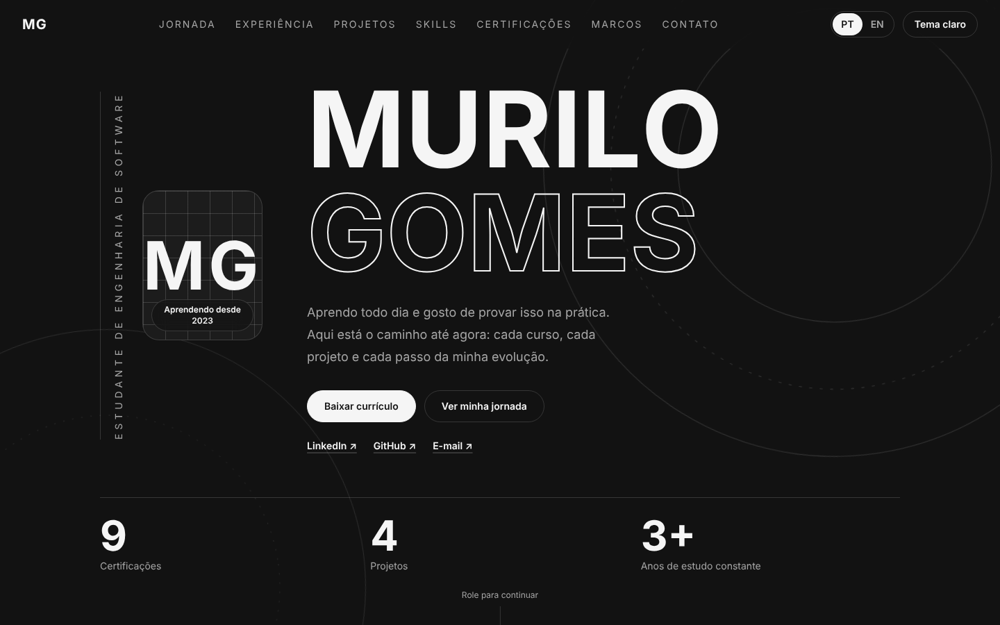
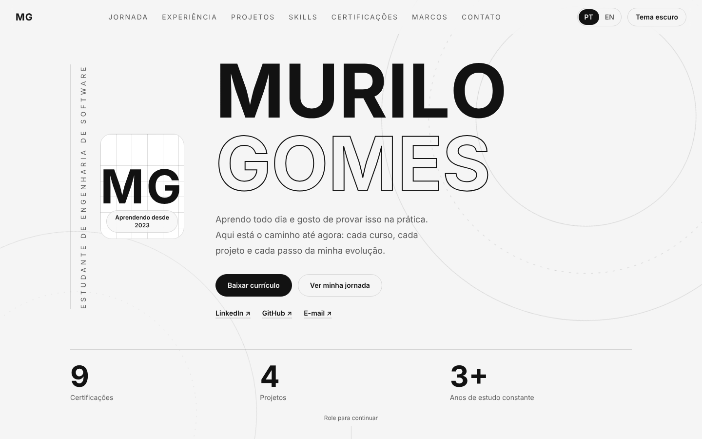
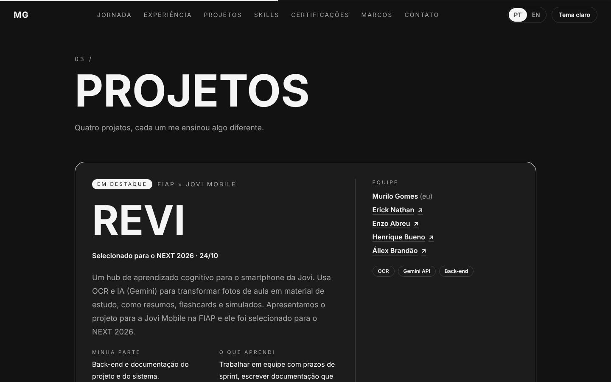
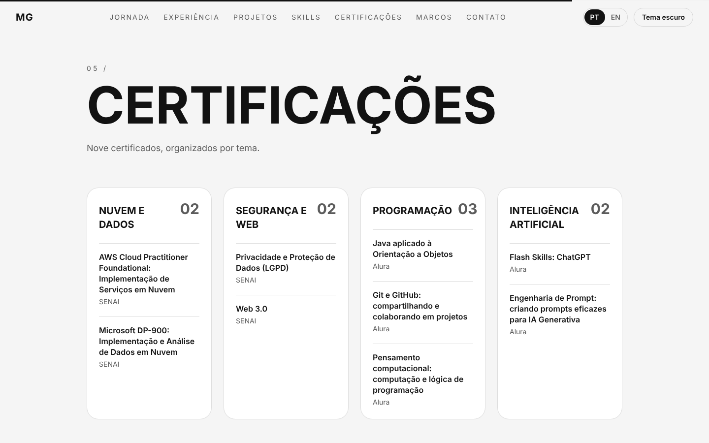
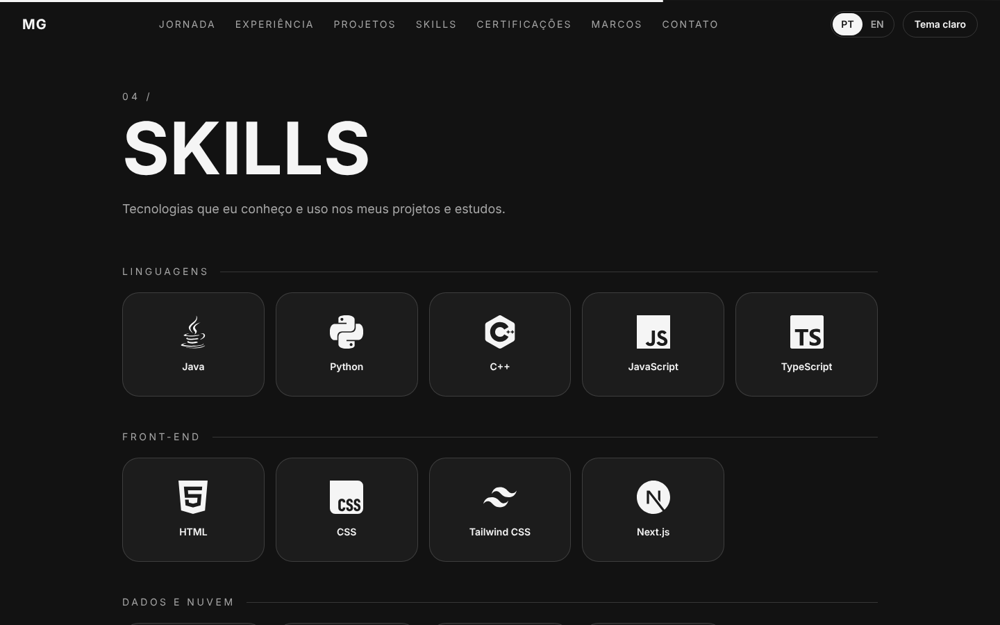
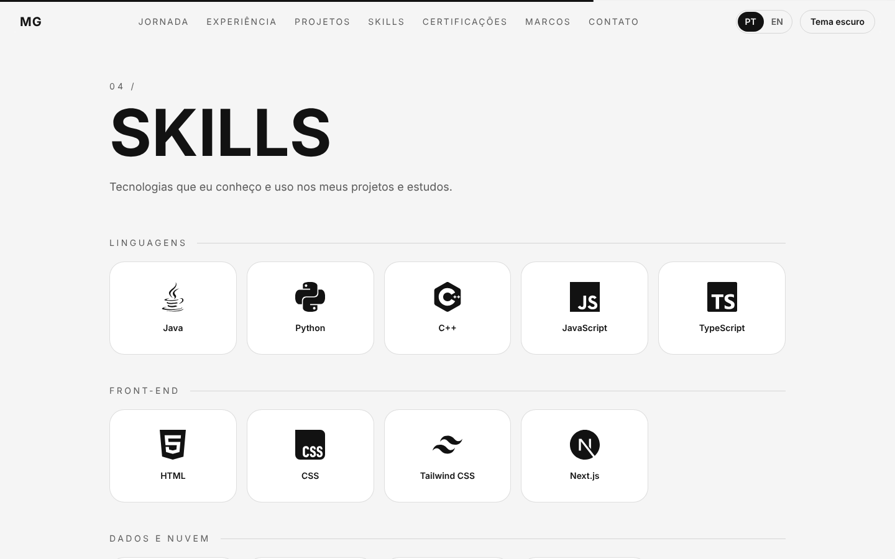
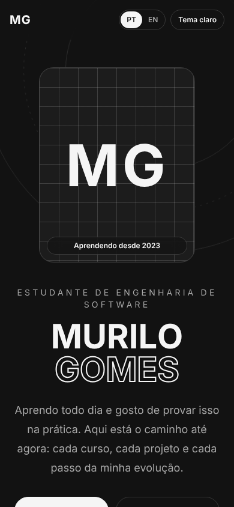
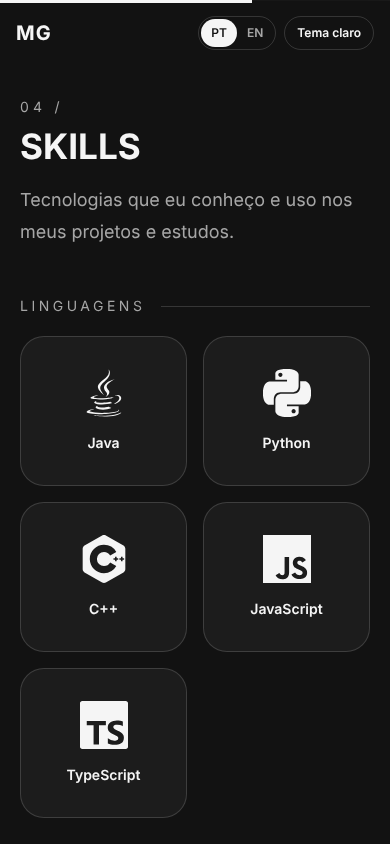

# 3.5 Resultado final

## Links

| Item | Link |
|---|---|
| **Repositório (CP06-de-Front)** | `https://github.com/Murilo-Vasconcelos/CP06-de-Front-End` |

## Prints do resultado

Todos em `docs/img/resultado/`.

| Tema escuro, computador | Tema claro, computador |
|---|---|
|  |  |
|  |  |
|  |  |

| Celular | |
|---|---|
|  |  |

## O que ficou pronto

- Portfólio de uma página, em português e inglês, com tema escuro e claro.
- Seções: Abertura, Jornada, Experiência, Projetos, **Skills (15 tecnologias com logo)**, Certificações, Marcos e Contato.
- Animações: intro com contador, rolagem suave, texto que acende palavra por palavra, linha do tempo que se desenha, cards que inclinam, botões magnéticos e troca de tema em círculo.
- Acessibilidade: link "pular para o conteúdo", foco visível no teclado, respeito a "reduzir movimento".
- QA completo no navegador (ver `04-registro-de-correcoes.md`), do celular de 320 px a telas de 1920 px.

## O que ficou de fora ou pendente

- Foto real (o site usa um espaço reservado até eu colocar a foto em `data/profile.ts`).
- Link do código do REVI (projeto em grupo ainda sob avaliação).
- O QA manual (Parte C4 do registro de correções) precisa ser feito por mim, em dispositivos reais.

## Reflexão

Neste projeto usei a IA para construir um portfólio inteiro e percebi que **o resultado depende muito do que eu levo de referência e de contexto**.

**O que as referências me deram.** Da primeira referência do Dribbble, o que mais me pegou foi a combinação das cores e a forma como o caminho da jornada seria mostrado. Isso virou a base do site: só preto, cinza e branco, e uma Jornada que conta minha trajetória em ordem. Na segunda, gostei do layout e das fontes, e isso ajudou a definir a organização das seções e a tipografia. Na última, o que mais me chamou atenção foi mostrar as skills com o logo de cada uma. Foi o que me fez pedir a seção Skills, que acabou sendo uma das partes mais claras do site para quem olha rápido.

**O que funcionou bem.** Quando expliquei o objetivo, o público (recrutadores de empresas grandes) e as restrições (preto, cinza e branco, animação dinâmica), o resultado veio muito mais perto do que eu imaginava. Trabalhar em passos pequenos, testando cada um no meu computador antes de seguir, também me deixou à vontade para pedir ajustes.

**O que eu faria diferente.** Vários ajustes poderiam ter sido evitados se eu tivesse colocado desde o primeiro prompt o posicionamento que eu queria (mostrar interesse em desenvolvimento de software em geral, sem me limitar a backend Java) e o nível de animação esperado. Também percebi que o código "rodar" não é o mesmo que estar pronto: o QA completo encontrou problemas que eu não teria visto sozinho, como a página rolando para o lado em celulares pequenos. Da próxima vez, vou pedir o checklist de testes logo no começo e anotar cada problema na hora em que aparece.

**O que aprendi sobre usar IA para programar.** A IA é muito rápida para montar e corrigir, mas quem decide o que fica bom sou eu: escolher as referências, conferir se o texto bate com a minha história e testar de verdade. Também aprendi a separar o que a IA entregou do que eu validei, e por isso o registro de correções diz quem achou cada problema.
